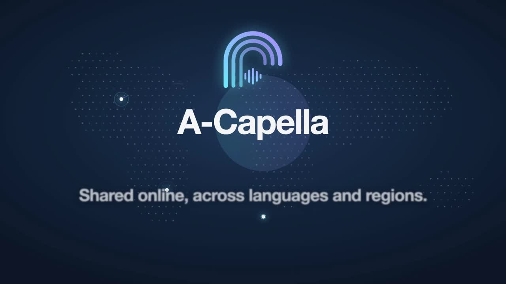

# A-Capella

[](docs/a-capella-keynote.mp4)

▶ [Watch the 2-minute film](docs/a-capella-keynote.mp4)

A Windows and macOS desktop app for recording and mixing multi-layer acapella videos: one singer records up to nine layers (melody, harmony, bass, beatbox…), and A-Capella combines them into a single grid video with all layers singing in sync.

## Features

- **Record or upload up to nine layers.** Layer 1 can be recorded live (webcam + mic) or uploaded from a file. Later layers are recorded while the earlier ones play back through headphones.
- **Automatic latency calibration.** A one-time click-track measurement compensates for recording delay, so layers recorded minutes apart line up sample-accurately.
- **Optional metronome** with adjustable BPM and time signature (2/4, 3/4, 4/4, 6/8); the first beat of each bar is accented.
- **Grid layouts.** Over 35 built-in arrangements for 1 to 9 layers (rows, columns, one big cell beside or above smaller ones, 2×2, 3×3…) picked from a thumbnail chooser (Layout ▸ Choose layout). The layout grows automatically when you add more layers than it has cells.
- **Video settings** (Layout ▸ Video settings): canvas shape (16:9, 1:1, 4:3 or 9:16), whether videos fill their cell (cropped) or fit inside it (letterboxed), an adjustable gap between cells and a background (a solid color, or a stretched or tiled image of your own). Preview and export use the same renderer, so what you see is what you get. Projects saved before these settings existed open with their original look.
- **Per-layer controls:** mirror a layer's picture, and nudge its timing earlier or later in 10 ms steps (1 ms with Shift) to line up a take that still sits slightly off.
- **Trim with a live preview.** The composited preview updates as trims, mixes and effects change; there's no render-to-see step.
- **Per-layer effects chain:** noise gate, EQ, compressor, limiter, reverb, pan and pitch correction, each switchable per layer, with level meters on the mixing screen.
- **VST3 plugin hosting.** If FabFilter Pro-Q 4, Pro-C 3, Pro-L 2, Pro-G or Pro-R 2 is installed, it is used for its slot and opened in its own editor window. Otherwise A-Capella falls back to its built-in processing.
- **Auto-Tune on macOS.** If Antares Auto-Tune (`AutoTune Advanced.vst3`) is installed, every layer gets a Pitch effect first in its chain, chosen from built-in presets (chromatic styles from Transparent to Hard Tune, or any major/minor key).
- **Melodyne pitch editing via ARA**, alongside a built-in automatic pitch-correction mode.
- **Undo/redo and project save/load**, including live plugin edits.
- **MP4 export.** Up to nine synced video feeds in the chosen grid layout with one mixed audio track. What you hear while editing is what gets exported.

## How it's built

- C# / .NET 8, [Avalonia](https://avaloniaui.net) UI (Windows and macOS)
- NAudio for the mixing/DSP engine; audio I/O is WASAPI on Windows and OpenAL on macOS
- FFmpeg (run as a subprocess over raw pipes) for capture, decode, encode and mux
- SkiaSharp for real-time grid compositing
- Rubber Band for the built-in pitch correction
- A native C++ module (`src/A-Capella.Host.Native`) built on JUCE that hosts VST3/ARA plugins and exposes a plain C ABI, called from C# via P/Invoke

```
src/A-Capella.App           Avalonia application
src/A-Capella.Engine        Audio, video, project, export and plugin-hosting logic
src/A-Capella.Host.Native   JUCE-based VST3/ARA host (C++)
tests/                     xUnit test suites for the engine and the app
tools/HardwareChecks       Manual real-hardware checks (devices, sync, throughput)
```

## Requirements

- Windows 10/11 (x64) or macOS 11+ (Apple silicon or Intel)
- [.NET 10 SDK](https://dotnet.microsoft.com/download) (the projects target .NET 8; Avalonia 12's code generators need the newer compiler that ships with the 10 SDK)
- [FFmpeg](https://ffmpeg.org/) with `ffmpeg` and `ffprobe` on `PATH` (macOS: `brew install ffmpeg`)
- To build the native plugin host:
  - Windows: Visual Studio Build Tools with the C++ workload (MSVC + Windows 10/11 SDK), [CMake](https://cmake.org/) 3.22+, [Ninja](https://ninja-build.org/) (`winget install Ninja-build.Ninja`)
  - macOS: Xcode Command Line Tools, CMake 3.22+ and Ninja (`brew install cmake ninja`)
- Optional: FabFilter and/or Melodyne VST3 installs (`C:\Program Files\Common Files\VST3` on Windows, `/Library/Audio/Plug-Ins/VST3` on macOS). The app works without them using its built-in effects.
- macOS: grant the terminal/app Camera and Microphone access when asked (System Settings > Privacy & Security). There is no built-in loopback device, so latency calibration listens to the speakers through the microphone unless a virtual loopback driver such as BlackHole is installed.

## Building

1. Build the native module (optional; needed only for VST3/ARA plugin hosting). It fetches JUCE and the ARA SDK itself on macOS:

   ```bash
   src/A-Capella.Host.Native/build.sh            # Debug (macOS)
   src/A-Capella.Host.Native/build.sh Release
   ```

   On Windows, clone the SDKs and use the PowerShell script instead:

   ```powershell
   cd src/A-Capella.Host.Native
   git clone --branch 8.0.6 --depth 1 https://github.com/juce-framework/JUCE.git JUCE
   git clone --recursive --branch releases/2.2.0 --depth 1 https://github.com/Celemony/ARA_SDK.git ARA_SDK
   powershell -File build.ps1            # or -Configuration Release
   ```

   `build.ps1` looks for MSVC under `D:\Tools\VisualStudio\BuildTools`, then `C:\Program Files\Microsoft Visual Studio\18\Community`; edit `$msvcRoot` at the top of the script if yours is elsewhere. On macOS, if the linker rejects the newest SDK ("unknown architecture" in a `.tbd`), set `SDKROOT` to an older one under `/Library/Developer/CommandLineTools/SDKs`. Re-run the script whenever `src/A-Capella.Host.Native` changes, *before* `dotnet build`: the app and test projects copy the library into their output.

2. Build, test and run the app:

   ```bash
   dotnet build A-Capella.sln
   dotnet test A-Capella.sln
   dotnet run --project src/A-Capella.App
   ```

   Tests that need a specific FabFilter or Melodyne plugin fail (Engine tests) or skip (App tests) when that plugin isn't installed. The App tests run headless; set `ACAPELLA_SCREENSHOT_DIR` to have them also write PNGs of the main window and dialogs.

## Roadmap (not built yet)

Ideas that need a hosted backend or are otherwise larger than a desktop-only change:

- Accounts and cloud-hosted collaboration: share a link instead of a zip, and invite people to record into your project.
- A feed, profiles, likes and comments for finished videos.
- Searching for songs and backing tracks to sing along with.
- One-click sharing to social networks.
- Recording length presets with an automatic stop and countdown.
- Carrying Melodyne (ARA) pitch edits across when layers are imported from another project; today an imported layer is analysed afresh.

   For everyday use, run a Release build: Debug builds of the plugin host are several times slower and can struggle with a full effects chain.

   ```powershell
   powershell -File src/A-Capella.Host.Native/build.ps1 -Configuration Release
   dotnet run -c Release --project src/A-Capella.App
   ```

## Third-party plugins

A-Capella never bundles or redistributes FabFilter or Melodyne plugins. It only hosts copies the user has installed and licensed themselves.

## License

Copyright (C) 2026 boenchen1112

Licensed under the GNU Affero General Public License v3.0. See [LICENSE](LICENSE). A-Capella links [JUCE](https://juce.com/), which is available under AGPLv3 (or a commercial license), and uses the [ARA SDK](https://github.com/Celemony/ARA_SDK) (Apache-2.0), [Rubber Band](https://breakfastquay.com/rubberband/) (GPL), NAudio (MIT) and SkiaSharp (MIT).

The bundled UI fonts, IBM Plex Sans and IBM Plex Mono (`src/A-Capella.App/Fonts/`), are Copyright © 2017 IBM Corp., licensed under the [SIL Open Font License 1.1](https://openfontlicense.org/).
